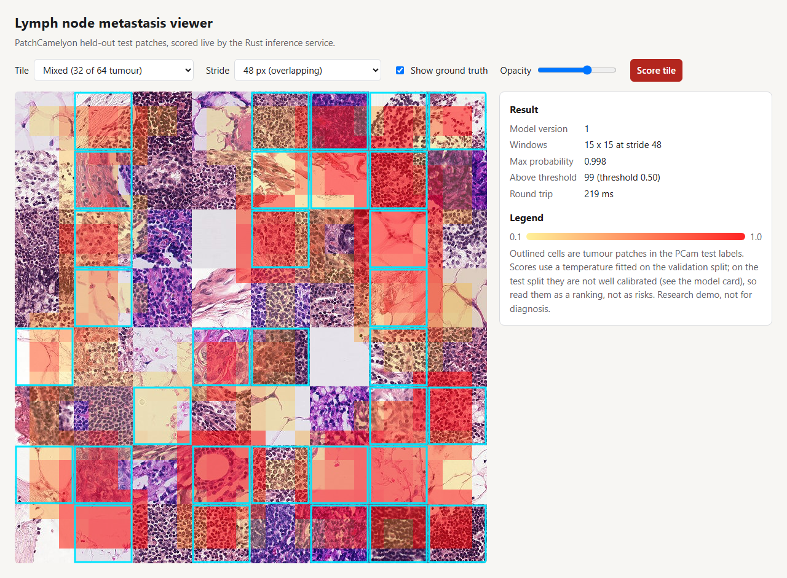
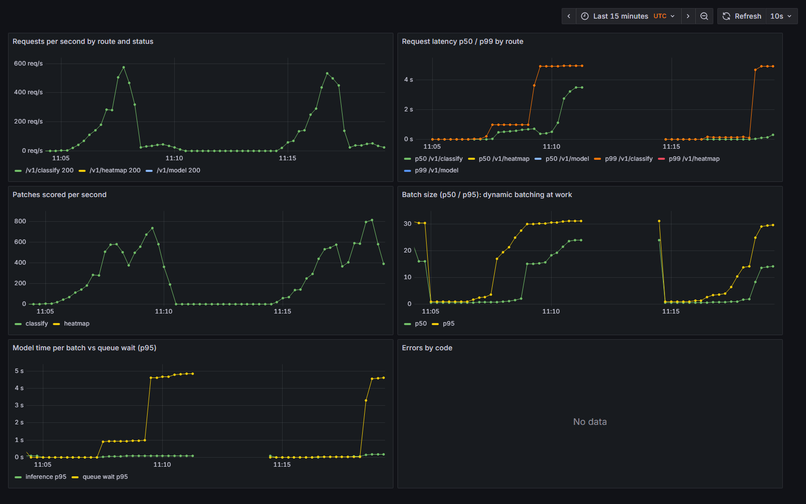
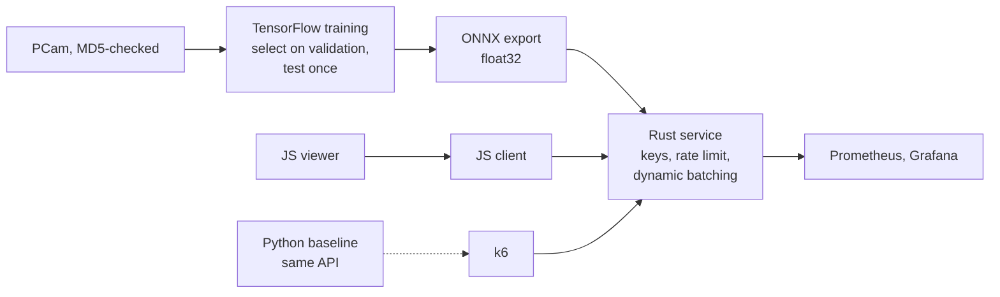

# Pathology inference in Rust

Finds metastatic tissue in lymph-node histopathology patches: a TensorFlow model trained on PatchCamelyon,
exported to ONNX, served by a Rust service (axum + ONNX Runtime) with dynamic batching, and a plain-JavaScript
viewer that draws tumour heatmaps over slide tiles. Research demo, not a medical device.



## Results (every number from a committed file)

| What | Result | Source |
|---|---|---|
| Data | 327,680 PatchCamelyon patches (CC0); all 9 files checked against Zenodo's MD5 sums; published splits unchanged | [`splits.json`](reports/splits.json) |
| Model | EfficientNetV2-B0 fine-tuned in mixed precision on an RTX 4060 (8.7 min); learning rate chosen on validation among three | [`selection-*.json`](reports), [model card](docs/MODEL-CARD.md) |
| Test split, scored once | **AUC 0.9409 (95% CI 0.9386-0.9435)**; the exported ONNX model the service runs: **0.9410**; 8-way test-time augmentation 0.9475; slide level 0.975 on 129 slides | [`metrics.json`](reports/metrics.json), [`onnx-test.json`](reports/onnx-test.json) |
| Where it falls short | Calibration fitted on validation did not transfer (test ECE 0.110); at 0.5 it finds 69.6% of tumour patches at 96.8% specificity | [model card](docs/MODEL-CARD.md) |
| Rust matches Python | The Rust service reproduces Python `onnxruntime` to **1.5e-8** on 16 real test patches, through its own decoding and batching (a CI test) | [`parity.rs`](service/tests/parity.rs) |
| Under load (4 CPUs each, k6) | At 800 single-patch requests/s the Rust service **serves all of them (p99 154 ms, 0 dropped)**; the Python baseline saturates at **486/s with p99 9.2 s** and drops 8,657 | [`reports/k6`](reports/k6) |
| At light load | Python is about 1 ms faster (p99 6.3 ms against 7.6 ms at 100 requests/s): batching waits up to 0.5 ms for company | same |
| Footprint | Service image 180 MB; Python baseline 977 MB | `docker image ls` |
| On Cloud Run (us-central1, 2 vCPU, scale to zero) | Same probabilities as the local model on the 16 test patches (max difference **2.9e-08**). First request after scaling to zero **2.35 s**, warm 0.19 s; k6 at 20, 50 and 100 single-patch requests/s: **0 failures, p99 136, 122 and 142 ms**, measured from a home connection in Tampa, so the network is most of it | [`reports/cloud-run`](reports/cloud-run) |

Every local timing is from one desktop: Intel i5-13600KF, 32 GB (WSL2 VM 15.5 GB), RTX 4060 8 GB, Docker Desktop.
The Cloud Run row is the deployed service, measured on 2026-10-18 ([DEPLOY.md](docs/DEPLOY.md)).

The first service configuration (2 workers x 2 threads, 2 ms window) lost to Python at every load below
saturation; the dashboard showed why, and [ADR 0003](docs/adr/0003-dynamic-batching-with-worker-owned-sessions.md)
has both runs.



## How it works



`POST /v1/classify` takes 1-64 patches, `POST /v1/heatmap` one tile up to 2048 px with sliding windows. Each worker
thread owns an ONNX Runtime session, so inference never waits on a lock. Details:
[ARCHITECTURE.md](docs/ARCHITECTURE.md), [RUNBOOK.md](docs/RUNBOOK.md), ADRs in [docs/adr](docs/adr).

## Try it (2 minutes; the trained model is in the repository)

```bash
make up    # Rust service :8080, viewer :8088, Prometheus :9097, Grafana :3007
```

Open http://localhost:8088, pick a tile and score it. From JavaScript:

```js
import { PathologyClient } from "@pathology/client";
const client = new PathologyClient({ baseUrl: "http://localhost:8080", apiKey: "local-dev-key-viewer-000001" });
const { results } = await client.classify([{ id: "p1", imageBase64 }]);
```

Reproduce the model on a CUDA GPU: `make data prepare select train LR=1e-3 evaluate-onnx assets model-card`.
Reproduce the comparison: `make compare bench`.

## Testing and CI

- **Rust:** 10 unit tests, 6 API tests on a fake model, and the parity test against the real model; rustfmt, clippy
  (pedantic, warnings as errors), `cargo audit`.
- **Python:** 25 tests (metrics against scikit-learn, data preparation and checksums, augmentation, ONNX export
  parity, the baseline API); ruff, mypy, pip-audit.
- **JavaScript:** 8 `node:test` tests for the client (98.8% line coverage), ESLint, `tsc --checkJs`, npm audit;
  **Playwright** scores a tile through the real service on desktop and mobile.
- **Ops:** 3 bats tests for the download script, 5 promtool scenarios for the 4 alerts, Terraform validate/tflint/
  trivy, image builds with a trivy scan, a compose smoke test that classifies a real patch, and gitleaks.

## Infrastructure

`infra/terraform` puts the service on Cloud Run with the model mounted from a versioned Cloud Storage bucket, API
keys from Secret Manager, deploys from GitHub Actions through Workload Identity Federation (no keys), a budget
alert and alert policies for 5xx and p99 latency. Validated and scanned in CI, and applied to a GCP project on
2026-10-18 (30 resources). That first apply found one bug: the budget needs a quota project when Terraform runs
with user credentials, now set on that resource alone.

## Limitations

- Not a medical device: PCam comes from one challenge (two Dutch centres); other scanners and stains will shift
  the inputs. The scores rank patches; they are not calibrated risks on the test split.
- The tiles in the viewer are mosaics of real test patches, not contiguous slide regions.
- Cloud Run latencies are measured from one home connection, so they are mostly network; the cloud load test
  stopped at 100 requests/s, so per-instance throughput on Cloud Run is not measured.

## How it was built

Four one-day sprints run as GitHub milestones, with issues, one pull request per sprint and a committed retro
each: [docs/sprints](docs/sprints). Research notes with sources: [RESEARCH.md](RESEARCH.md).

Data: PatchCamelyon, Veeling et al. 2018 (CC0). Code: MIT.
