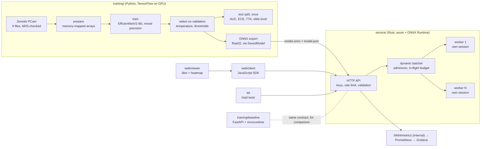

# Architecture

## Request path

1. `POST /v1/classify` (1-64 base64 PNG/JPEG patches of 96x96) or `POST /v1/heatmap` (one tile up to 2048 px,
   sliding windows at a stride of at least 32 px).
2. The API checks the key (constant-time comparison over every key) and reads each image header. A heatmap's
   window count comes from the header, so a tile over `MAX_WINDOWS_PER_REQUEST` is refused, and the client's
   rate limit charged per patch, before any pixel is decoded.
3. The request then reserves all of its patches among `MAX_PENDING_PATCHES`, the work admitted but not yet
   answered; with no room after `ADMIT_TIMEOUT_MS` it is refused with 503 `overloaded` and `Retry-After: 1`. A
   refused request has decoded no pixels, and an admitted one waits behind at most that much work. The images are
   decoded and validated, and the request is split into jobs of up to `MAX_BATCH` patches. Each job takes that
   many permits from an in-flight budget (`MAX_INFLIGHT_PATCHES`) before its pixels are laid out as NHWC float32
   (0-255; normalisation is inside the model), and gives them back when it is done. The collector forms a batch
   of up to `MAX_BATCH` patches or waits at most `MAX_WAIT_US` after the first job.

   Model inputs are therefore bounded by the budget plus the batch each worker copies its jobs into:
   (`MAX_INFLIGHT_PATCHES` + `WORKERS` x `MAX_BATCH`) x 108 KiB, however many requests arrive. With the compose
   settings (512 + 4 x 32 patches) that is 67.5 MiB, and a maximal heatmap adds its decoded tile (12 MiB at
   2048 px), so 79.5 MiB in all, against 829.6 MiB when every window was laid out at once. The heap test
   (`service/tests/heatmap_memory.rs`, 2 workers, so a bound of 72.75 MiB) paces its fake model at 2 ms a batch so
   the budget fills as it does with the real model; in release builds one 2048 px tile at stride 32 (3,844
   windows) peaked at 67.9 MiB in each of six runs. Request bodies are outside the budget: each is up to 16 MB
   and is read before admission, so their memory grows with the number of requests in flight (at most 64 per
   Cloud Run instance).
4. Each worker thread owns an ONNX Runtime session (`Session::run` needs exclusive access), so inference never
   waits on a lock. Probabilities are `sigmoid(logit / temperature)` with the temperature fitted on validation.
5. A request that times out (20 s) or whose client disconnects has its queued jobs dropped unscored. A failed
   batch fails every request in it with 503.

## Model lifecycle

| Step | Command | Output |
|---|---|---|
| Download and verify | `make data` | `data/raw/` (8.1 GB), MD5 against Zenodo |
| Prepare | `make prepare` | memory-mapped `.npy` arrays, `reports/splits.json` |
| Select | `make select` | `reports/selection-lr*.json` (validation only) |
| Train, evaluate once, export | `make train LR=...` | `models/pcam/1/`, `reports/metrics.json` |
| Fixtures and demo tiles | `make assets` | `service/tests/fixtures/`, `web/viewer/public/demo/` |
| Model card | `make model-card` | `docs/MODEL-CARD.md` |

The Rust parity test reproduces the probabilities `onnxruntime` in Python gave for 16 real test patches, through
the service's own decoding and batching, so a change to either side that shifts a score fails CI.

## Where it runs

| | Local / CI | GCP (designed, not applied) |
|---|---|---|
| Service | `docker compose` (`make up`) | Cloud Run, model mounted from Cloud Storage, keys from Secret Manager |
| Viewer | nginx container on :8088 | any static host, built with the service URL |
| Monitoring | Prometheus :9097, Grafana :3007 | Cloud Monitoring alert policies (5xx, p99 latency) |
| Deploys | | GitHub Actions through Workload Identity Federation, no keys |
