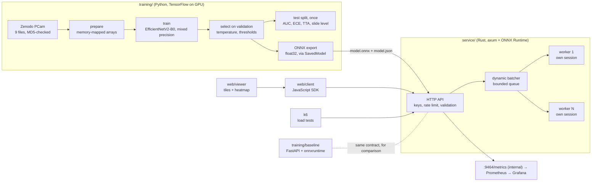

# Architecture

## Request path

1. `POST /v1/classify` (1-64 base64 PNG/JPEG patches of 96x96) or `POST /v1/heatmap` (one tile up to 2048 px,
   sliding windows at a stride of at least 32 px).
2. The API checks the key (constant-time comparison over every key) and reads each image header. A heatmap's
   window count comes from the header, so a tile over `MAX_WINDOWS_PER_REQUEST` is refused, and the client's
   rate limit charged per patch, before any pixel is decoded. Then it decodes and validates the images.
3. The request is split into jobs of up to `MAX_BATCH` patches. Each job takes that many permits from an
   in-flight budget (`MAX_INFLIGHT_PATCHES`) before its pixels are laid out as NHWC float32 (0-255;
   normalisation is inside the model), and gives them back when it is done, so model inputs never take more than
   the budget (512 patches, 54 MiB) however many requests arrive. With a counting allocator and the fake model,
   one 2048 px tile at stride 32 (3,844 windows) peaked at 72.6 MiB of heap, against 829.6 MiB when every window
   was laid out at once. The collector forms a batch of up to `MAX_BATCH` patches or waits at most `MAX_WAIT_US`
   after the first job.
4. Each worker thread owns an ONNX Runtime session (`Session::run` needs exclusive access), so inference never
   waits on a lock. Probabilities are `sigmoid(logit / temperature)` with the temperature fitted on validation.
5. A request that finds the budget full for `ADMIT_TIMEOUT_MS` is refused with 503 `overloaded` and
   `Retry-After: 1`. A request that times out (20 s) or whose client disconnects has its queued jobs dropped
   unscored. A failed batch fails every request in it with 503.

## Model lifecycle

| Step | Command | Output |
|---|---|---|
| Download and verify | `make data` | `data/raw/` (8.1 GB), MD5 against Zenodo |
| Prepare | `make prepare` | memory-mapped `.npy` arrays, `reports/splits.json` |
| Select | `make select` | `reports/selection-lr*.json` (validation only) |
| Train, evaluate once, export | `make train LR=...` | `models/pcam/1/`, `reports/metrics.json` |
| Fixtures and demo tiles | `make assets` | `service/tests/fixtures/`, `web/viewer/public/demo/` |
| Model card | `make model-card` | `docs/MODEL-CARD.md` |

The Rust parity test reproduces the probabilities `onnxruntime` in Python gave for 16 real test patches, through
the service's own decoding and batching, so a change to either side that shifts a score fails CI.

## Where it runs

| | Local / CI | GCP (designed, not applied) |
|---|---|---|
| Service | `docker compose` (`make up`) | Cloud Run, model mounted from Cloud Storage, keys from Secret Manager |
| Viewer | nginx container on :8088 | any static host, built with the service URL |
| Monitoring | Prometheus :9097, Grafana :3007 | Cloud Monitoring alert policies (5xx, p99 latency) |
| Deploys | | GitHub Actions through Workload Identity Federation, no keys |
