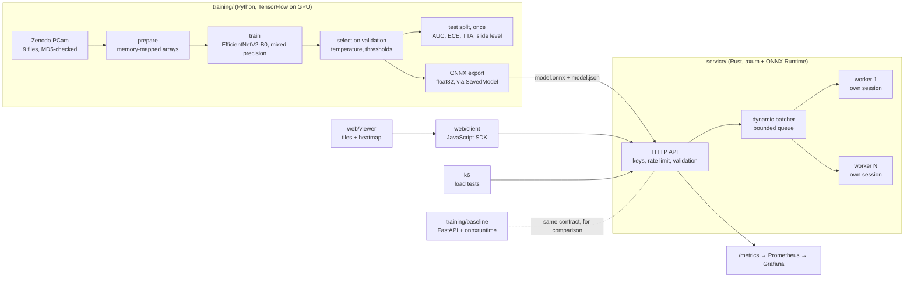

# Architecture

## Request path

1. `POST /v1/classify` (1-64 base64 PNG/JPEG patches of 96x96) or `POST /v1/heatmap` (one tile up to 2048 px,
   sliding windows at a stride of at least 32 px).
2. The API checks the key (constant-time comparison over every key), charges the client's rate limit per
   patch, decodes and validates the images, and lays out pixels as NHWC float32 (0-255; normalisation is inside
   the model).
3. Jobs go into a bounded queue. The collector forms a batch of up to `MAX_BATCH` patches or waits at most
   `MAX_WAIT_US` after the first job; a tile larger than one batch is split across several.
4. Each worker thread owns an ONNX Runtime session (`Session::run` needs exclusive access), so inference never
   waits on a lock. Probabilities are `sigmoid(logit / temperature)` with the temperature fitted on validation.
5. A full queue pushes back on the request; a failed batch fails every request in it with 503.

## Model lifecycle

| Step | Command | Output |
|---|---|---|
| Download and verify | `make data` | `data/raw/` (8.1 GB), MD5 against Zenodo |
| Prepare | `make prepare` | memory-mapped `.npy` arrays, `reports/splits.json` |
| Select | `make select` | `reports/selection-lr*.json` (validation only) |
| Train, evaluate once, export | `make train LR=...` | `models/pcam/1/`, `reports/metrics.json` |
| Fixtures and demo tiles | `make assets` | `service/tests/fixtures/`, `web/viewer/public/demo/` |
| Model card | `make model-card` | `docs/MODEL-CARD.md` |

The Rust parity test reproduces the probabilities `onnxruntime` in Python gave for 16 real test patches, through
the service's own decoding and batching, so a change to either side that shifts a score fails CI.

## Where it runs

| | Local / CI | GCP (designed, not applied) |
|---|---|---|
| Service | `docker compose` (`make up`) | Cloud Run, model mounted from Cloud Storage, keys from Secret Manager |
| Viewer | nginx container on :8088 | any static host, built with the service URL |
| Monitoring | Prometheus :9097, Grafana :3007 | Cloud Monitoring alert policies (5xx, p99 latency) |
| Deploys | | GitHub Actions through Workload Identity Federation, no keys |
